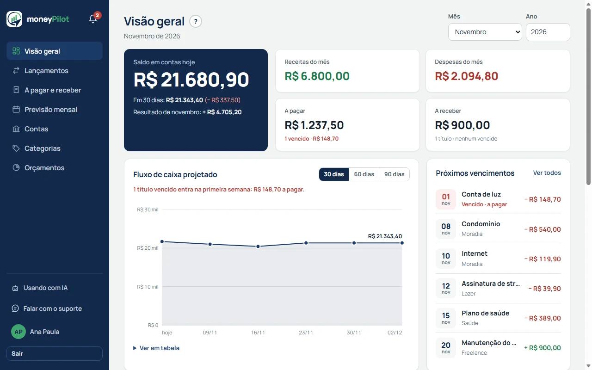
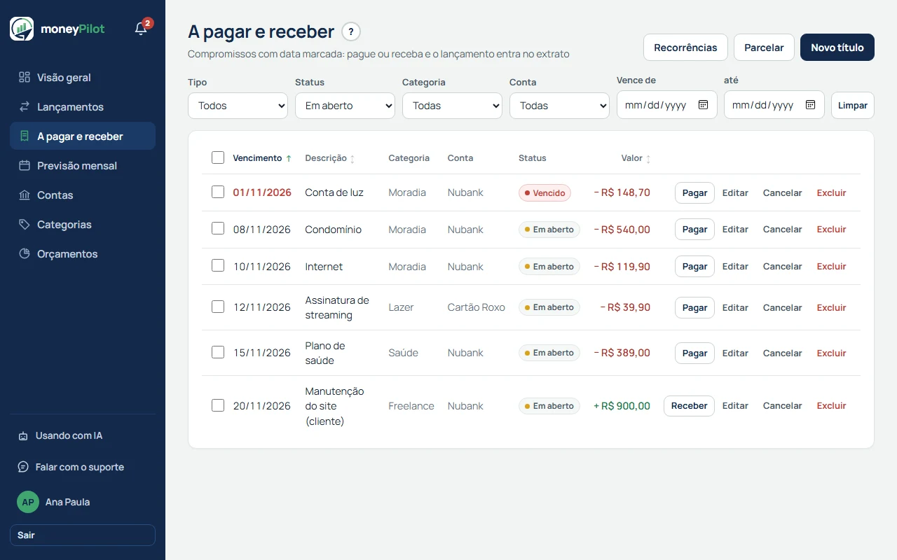
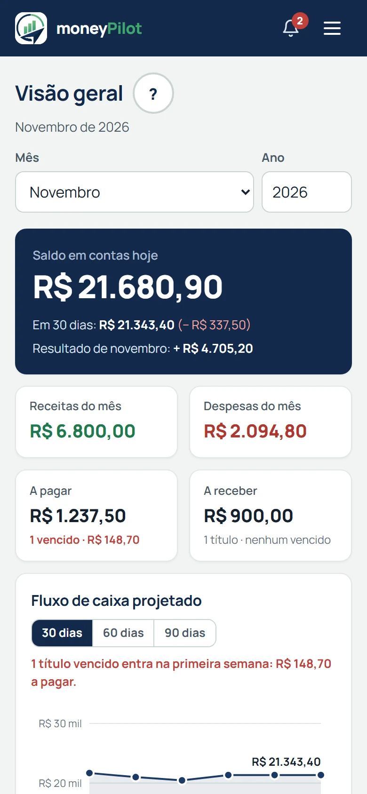

# moneyPilot

> Seu dinheiro. Seu rumo. Seu futuro.

**[Abrir o moneyPilot](https://moneypilot.desenvolvedorgustavolopes.com.br/)**

Controle financeiro pessoal, gratuito e de código aberto: contas, lançamentos, orçamento mensal, contas a pagar e a receber e previsão de fluxo de caixa, em uma interface que funciona bem no computador e no celular.

<p align="center">
  
</p>

<p align="center">
  
  &nbsp;
  
</p>

<sub>Imagens geradas com dados fictícios.</sub>

**Stack:** Java 21 · Spring Boot · PostgreSQL · Flyway · JavaScript puro, sem build · Testcontainers · Docker.

Os detalhes de produto, arquitetura, API e deploy estão abaixo. As funcionalidades nascem de [specs públicas](specs/README.md) (Spec-Driven Development).

Aplicação de controle financeiro pessoal: contas, lançamentos, transferências, orçamento mensal, contas a pagar e a receber (com parcelamento, baixa em lote e recorrência), previsão de fluxo de caixa e relatórios. Backend em Spring Boot com API REST, e um cliente web servido pela própria aplicação.

## Stack

| Camada | Tecnologia |
|---|---|
| Linguagem | Java 21 |
| Framework | Spring Boot 4.1.1 (Web MVC, Data JPA, Security, Validation, Actuator) |
| Banco | PostgreSQL 18 |
| Migrations | Flyway |
| Autenticação | JWT stateless de curta duração (jjwt 0.12.6) + refresh token rotativo em cookie httpOnly; senha com BCrypt |
| Documentação da API | springdoc-openapi 3.x (Swagger UI) |
| Testes | JUnit 5, MockMvc e Testcontainers (Postgres real); `node --test` para o cliente web |
| CI | GitHub Actions |
| Deploy | Docker Compose em VPS, imagem publicada no GHCR, HTTPS pelo Caddy |
| Build | Maven (wrapper incluso) |
| Frontend | HTML, CSS e JavaScript puro com ES modules, sem build step e sem biblioteca de gráficos |

## Arquitetura

**Pacotes por domínio**, não por camada técnica. Cada domínio concentra entidade, repositório, records de request/response, service e controller:

```
br.com.desenvolvedorgustavolopes.moneyPilot
├── auth          registro, verificação de conta, login, reset de senha, refresh token, filtro JWT, usuário autenticado, perfil e troca de senha e de e-mail
├── account       contas e saldo
├── category      categorias do usuário e do sistema
├── transaction   lançamentos e transferências
├── budget        orçamento por categoria e mês
├── bill          títulos a pagar/receber, parcelamento, baixa e recorrência
├── report        consultas agregadas, previsão de fluxo de caixa
├── notification  alertas calculados (vencimentos e orçamento) e dispensa
├── config        Spring Security, Clock, host canônico
└── exception     exceções de domínio e handler global
```

### Decisões que valem saber antes de mexer

**Base**

- **Flyway é a única fonte de verdade do schema.** `spring.jpa.hibernate.ddl-auto=validate` em todo ambiente: entidade que não casar com a migration derruba a aplicação no boot, de propósito. Migration já aplicada nunca se edita — o Flyway compara checksum.
- **Regras de estado vivem em CHECKs do Postgres**, e o Hibernate não os valida. Violação chega como `DataIntegrityViolationException`; o código checa antes para devolver um erro que explique o problema.
- **Dinheiro é `BigDecimal` com escala 2**, moeda única (BRL).
- **Saldo é calculado em leitura**, nunca persistido: `initial_balance` da conta somado às receitas menos as despesas dos lançamentos.
- **Saldo disponível e guardado** (spec 015): cada conta tem `counts_as_available` (`countsAsAvailable` na API). O saldo em destaque e o `currentBalance` das duas previsões somam só as contas marcadas; as desmarcadas formam o "Guardado". Padrão por tipo: `INVESTMENT` desmarcada, as demais marcadas (o cartão de crédito sem fatura configurada segue marcado; com fechamento e vencimento informados, sai do disponível: spec 016). Campo opcional: na criação, omitido usa o padrão do tipo; na edição, omitido mantém o valor, ou usa o padrão do novo tipo se o tipo mudou. `/accounts/{id}/balance`, extrato, transferências, relatórios e orçamento não mudam.
- **Fatura do cartão** (spec 016): o cartão de crédito pode ter `closing_day` e `due_day` (1 a 31, sempre os dois, só nesse tipo; em mês curto vale o último dia) e `invoices_from`, o início das faturas: por padrão o ciclo em que os dias foram informados pela primeira vez, ou o ciclo da data escolhida em `invoicesFrom` (não pode ser futura; só vale com os dois dias; uma data anterior traz fatura antiga ou atrasada, que aparece como vencida até ser paga). A fatura é **calculada em leitura**, nada é gravado: o ciclo vai do dia do fechamento até a véspera do seguinte (a compra no dia do fechamento cai na próxima fatura) e o vencimento é o primeiro `due_day` depois do fechamento (`InvoiceCycle`). Total do ciclo = despesas menos receitas (estorno é receita); transferências e tudo antes de `invoices_from` ficam de fora. O **pagamento é uma transferência para o cartão** (rota de transferência existente, sem rota nova) e abate das faturas mais antigas para as mais novas: parcial deixa o resto na fatura, a mais vira crédito nas seguintes, sem juros. Compra parcelada são N despesas ligadas por `installment_group_id` (o centavo que sobra fica na primeira); apagar uma parcela remove o grupo; a edição e o estorno de parcela estão na spec 028 (abaixo). Cartão fora do disponível, com dias, soma cada fatura não quitada como saída no vencimento nas duas previsões (vencida cai no primeiro período); cartão marcado não projeta. A fatura não vira título (`Bill`), mas **aparece como uma conta a pagar calculada**: `GET /invoices/payable` devolve as faturas aberta, fechada e vencida com valor a pagar (a futura fica de fora). Elas viram uma linha por fatura no topo de "A pagar e receber" (com "Ver itens da fatura" e "Pagar fatura"; fora da paginação, da ordenação e da seleção em lote), somam no quadro "A pagar" da Visão geral, entram em "Próximos vencimentos" e nos alertas de a pagar (só fechada ou vencida; a aberta não alerta). "Guardado" não inclui cartões. Relatórios e orçamento não mudam. **Compra recorrente no cartão** (emenda à 016, regras 31 a 38): a assinatura é uma regra em `recurring_purchases` (descrição, categoria de despesa, valor, dia do mês, início e fim opcional, `active`) e a cobrança vira uma **despesa no cartão** na data, sem ação da pessoa. A geração é sob demanda (`POST /recurring-purchases/materialize`, chamado pelo app uma vez por sessão) e idempotente: `generated_until` guarda a data da última cobrança gerada e o que já foi gerado se mede **em meses** (`RecurringPurchaseSchedule`), então gerar duas vezes não duplica, trocar o dia depois de gerar não cobra o mês de novo e **apagar uma cobrança gerada não a recria**; o avanço da marca é um `UPDATE` condicional, seguro em chamadas simultâneas. A cobrança é um lançamento comum (`recurring_purchase_id`), editável e apagável; apagar a regra mantém as geradas. As cobranças ainda não geradas são **projetadas** (nada gravado): `projectedTotal` na fatura (tela Faturas, até o fim do ciclo seguinte ao atual) e nas duas previsões (até o horizonte, pelo vencimento da fatura), nunca contadas duas vezes porque a projeção começa depois de `generated_until`; "A pagar e receber", a Visão geral e os alertas não incluem o previsto. Título e recorrência de título novos ou editados com conta = cartão com dias respondem `400` no campo `accountId` (baixar um título no cartão continua permitido; os existentes não mudam).
- **Transferência é um par de lançamentos** ligados por `transfer_group_id` — uma saída e uma entrada, sem categoria. Não é um tipo especial de lançamento. Transferência não pode ser editada, e apagar uma perna apaga o par.
- **Categorias são flat** (sem hierarquia) e podem ser globais (`user_id` nulo, criadas por migration) ou do usuário. Categoria global é visível para todos e não pode ser editada nem apagada.
- **Todo acesso é escopado ao usuário autenticado.** Recurso de outro usuário responde `404`, nunca `403`: a API não confirma a existência do que não é seu.
- **"Hoje" vem de um `Clock` injetado**, fixado em `America/Sao_Paulo`. O servidor roda em UTC; sem isso, depois das 21h um título que vence hoje apareceria como vencido. Nos testes o `Clock` é substituído por um relógio fixo.

**Títulos (contas a pagar e a receber)**

- **Título não é lançamento.** Ele é um compromisso com data; só ao ser **baixado** gera o lançamento no extrato, com o sinal invertido conforme o tipo (`PAYABLE` vira despesa, `RECEIVABLE` vira receita).
- **`OVERDUE` não existe no banco.** O status persistido é `OPEN`, `SETTLED` ou `CANCELED`; "vencido" é `OPEN` com vencimento antes de hoje, traduzido no service.
- **A baixa é à prova de duplo clique**: `UPDATE ... WHERE status = 'OPEN'` condicional, e zero linhas afetadas vira `409`. Dois cliques nunca geram dois lançamentos.
- **A baixa tem data própria** (`settledOn`, opcional, padrão hoje, nunca no futuro): o lançamento entra no dia em que o dinheiro saiu ou entrou, não no dia do registro. O "baixado no mês" do resumo segue essa data.
- **Pagamento com juros ou multa** é baixado pelo valor efetivamente pago, maior que o do título; o lançamento registra esse valor.
- **Baixar por valor menor quita o título inteiro.** Um título de R$ 100,00 baixado com R$ 95,00 fica `SETTLED`, sem resíduo. É intencional e a tela avisa.
- **Lançamento gerado por baixa não se edita nem se apaga** pelo endpoint de transações (`409`); o caminho é `unsettle`, que apaga o lançamento e reabre o título. Esses lançamentos chegam com `billId` e `billType`, e a tela os marca como pagamento ou recebimento de título.
- **Itens da fatura: editar, estornar e adiantar** (spec 028, emenda à 016): a parcela de compra no cartão **se edita** (`PUT /transactions/{id}?scope=ONLY_THIS|THIS_AND_FOLLOWING`, padrão `ONLY_THIS`): em `THIS_AND_FOLLOWING`, descrição, categoria e valor valem para as parcelas de número maior ou igual e a data muda só a da editada; conta e tipo da parcela não mudam (`400`) e `scope` fora de parcela com `THIS_AND_FOLLOWING` dá `400`. **Estornar** (`POST /transactions/{id}/refund`, `{date, scope}` com `ONLY_THIS|THIS_AND_FOLLOWING|WHOLE_PURCHASE`) cria uma **receita no mesmo cartão**, do valor inteiro da compra (não há estorno parcial), na categoria global **"Estorno"** (criada pela `V22`, sem escolha), ligada à compra por `refund_of_transaction_id` (índice único: um estorno por compra, mesmo em pedidos simultâneos). A data de cada estorno é a **maior entre a informada e a da parcela**; parcelas já estornadas são puladas e, se nenhuma restar, `409`. A resposta do lançamento traz `refundOfTransactionId` (no estorno) e `refundTransactionId` (na compra estornada). **Desfazer** é apagar a receita do estorno (`DELETE /transactions/{idDoEstorno}`). Dão `409`: estornar o que não é despesa de cartão, editar ou apagar compra ou parcela estornada (em "esta e as seguintes", se alguma do alcance estiver estornada, a edição toda é recusada) e editar o estorno. O pagamento adiantado não mudou de regra (transferência de qualquer valor, abate da fatura mais antiga): a tela lista as faturas **da mais antiga para a mais nova, abrindo em "Não pagas"**, mostra o selo "Paga adiantada" na fatura aberta quitada, "pago R$ X, falta R$ Y" no pagamento parcial e, no diálogo de pagar, uma prévia de onde o valor cai.
- **Parcelamento divide com arredondamento DOWN e o resíduo em centavos na primeira parcela** (100,00 / 3 → 33,34 + 33,33 + 33,33). Vencimentos partem sempre da data original (`firstDueDate.plusMonths(i)`), então 31/01 vira 28/02 e volta a 31/03.
- **Baixa em lote é tudo ou nada** (até 200 títulos) e o erro cita o id que falhou.
- **Recorrência é materializada sob demanda e de forma idempotente**, sem scheduler: chamar duas vezes para o mesmo mês não cria nada na segunda. O dia 31 é limitado ao último dia do mês.

**Sessão**

- **Access token de 15 minutos, refresh token de 30 dias.** O refresh é opaco (256 bits), gravado como SHA-256, entregue em cookie `httpOnly` + `Secure` + `SameSite=Strict` (restrito a `/api/v1/auth`) e rotacionado a cada uso.
- **Refresh token no corpo, só se o cliente pedir (spec 011).** O navegador segue só com o cookie e a resposta dele não traz `refreshToken`. Um cliente fora do navegador manda `refreshTokenInBody: true` no login e recebe `{token, refreshToken, expiresIn}` sem `Set-Cookie`; renovação e logout aceitam `{refreshToken}` no corpo, e mandar o token no corpo já liga o modo. Cookie e corpo juntos: vale o corpo e o cookie é ignorado. Rotação e detecção de reuso são as mesmas do cookie. Não há tokens de API pessoais nem CORS aberto, por decisão. A troca de senha pelo app encerra as sessões da API.
- **Dinheiro nas bordas da API recusa mais de 2 casas.** Todo campo de dinheiro dos requests tem `@Digits(integer = 17, fraction = 2)`; `10.555` ou `"10,50"` respondem `400` com erro no campo, em vez de o banco arredondar sem avisar.
- **Reuso de refresh token já rotacionado revoga a família inteira** daquele usuário — sinal de token vazado.
- **O cliente faz uma única renovação compartilhada** quando várias chamadas recebem `401` ao mesmo tempo; uma renovação por chamada se autoinvalidaria pela detecção de reuso.
- **Limite de tentativas no login e no cadastro**, em memória e por janela fixa (`AttemptLimiter`). Login: 10 tentativas por IP e 3 falhas por e-mail a cada 15 min — o bloqueio por e-mail vale de qualquer IP e recusa até a senha certa; login bem-sucedido zera as falhas. Cadastro: 3 por IP por hora, contando também e-mail já cadastrado. Excedido, responde `429` com `Retry-After`. O IP vem do `X-Forwarded-For` do Caddy (`server.forward-headers-strategy=framework`). Os contadores zeram no restart (uma instância só); limites em `app.rate-limit.*`.
- **Só entra quem verificou o e-mail.** A conta nasce não verificada e recebe um link (`/app/#/verificar-email?token=…`, 256 bits, só o SHA-256 no banco, 24 horas, uso único, uma linha por usuário: reenviar invalida o anterior). O link verifica, mas não abre sessão. Login de conta não verificada com a senha certa responde `403`; com a senha errada, o `401` de sempre. Contas criadas antes da verificação existir entram como verificadas (`V12`).
- **Cadastro e reenvio não revelam quais e-mails existem.** O cadastro responde sempre `202` sem corpo: e-mail livre cria a conta e manda o link; e-mail de conta não verificada reaproveita a conta com o nome e a senha novos e manda outro link; e-mail de conta verificada não grava nada e avisa o dono (no máximo 1 aviso por hora). Falha no envio do link desfaz o cadastro (`502`). O reenvio responde sempre `202`; para conta já verificada, manda um e-mail dizendo que ela está ativa. Limites do reenvio: 3 por e-mail e 10 por IP por hora.
- **E-mail sem distinção de maiúsculas.** Cadastro, login, reenvio e troca gravam e buscam o e-mail sem espaços nas pontas e em minúsculas (`EmailAddress.normalize`); a `V12` converteu os existentes e um `CHECK` no banco recusa o que fugir disso.
- **Reset de senha por link, sem revelar quem tem conta.** "Esqueci a senha" responde sempre `202`; só e-mail cadastrado recebe o link (`/app/#/redefinir-senha?token=…`, 256 bits, só o SHA-256 no banco, **30 minutos**, uso único, uma linha por usuário: pedir de novo invalida o anterior). Redefinir grava a senha nova (mesmas regras do cadastro, inclusive a política de senha; igual à atual é aceita), verifica a conta se ainda não estava, apaga **todos** os refresh tokens, zera o bloqueio de login por falhas daquele e-mail e avisa o e-mail da conta (falha no aviso só vai para o log). O link não abre sessão. Limites: 3 pedidos por e-mail e 5 por IP por hora.
- **Falar com o suporte grava o chamado e manda um e-mail** (specs 010 e 017). `POST /support/tickets` valida o chamado, grava em `support_tickets` (status `OPEN`) e envia uma mensagem ao endereço `SUPPORT_EMAIL`, com o e-mail da pessoa no `Reply-To` (responder é só clicar em "Responder"). Logado, vale o e-mail e o nome da conta e o `email` do corpo é ignorado; sem login o `email` é obrigatório. A rota é pública porque quem não consegue entrar também precisa dela; um `Authorization: Bearer` recusado (expirado) responde `401` para o cliente renovar a sessão em vez de tratar como anônimo. Categorias: Dúvida, Problema, Sugestão e Outro; mensagem de 10 a 2.000 caracteres (sem os espaços das pontas), enviada como texto puro. Cada chamado ganha um número curto de 6 caracteres, mostrado na confirmação e no assunto do e-mail. Limites: 3 por hora por conta (ou por e-mail, sem login) e 10 por hora por IP, **contando todo chamado gravado**. Se o e-mail ao suporte falhar, o chamado **fica gravado mesmo assim** (`email_sent = false`) e a resposta é `200` com a referência: a pessoa vê "recebido" e o painel marca "e-mail não enviado". Sem cópia para a pessoa e sem histórico da conversa.
- **Painel de chamados só para administrador** (spec 017). Não há papel gravado: é administrador a conta cujo e-mail atual está em `ADMIN_EMAILS` (lista separada por vírgula, sem diferenciar maiúsculas; vazia = ninguém). Trocar o e-mail da conta tira o acesso até a variável ser atualizada. As rotas `/admin/support/tickets` respondem `401` sem login e `404` para quem não é administrador. O status vai de `OPEN` (Aberto) a `IN_PROGRESS` (Em andamento) e `RESOLVED` (Resolvido), com reabertura; a resposta à pessoa segue pelo e-mail. Chamados anteriores à 017 só existem no e-mail.
- **Meus chamados** (spec 018). `GET /support/tickets` lista só os chamados ligados à conta logada (`user_id`), mais recentes primeiro, 10 por página, e `GET /support/tickets/{reference}` abre um deles com a mensagem e o e-mail da resposta. Chamado sem login (mesmo com o e-mail da conta) e chamado anterior à 017 não entram. Chamado de outra conta responde `404`. As respostas não trazem `id` nem `emailSent`: a pessoa não vê se o e-mail ao suporte falhou. Reabrir não existe para a pessoa; a resposta continua só por e-mail.
- **Apoie o projeto** (spec 019). O moneyPilot é gratuito; apoiar é voluntário, por Pix, e nada no app depende disso. `GET /contribution/pix` devolve a chave Pix (uma **chave aleatória**, nunca CPF, telefone ou e-mail pessoal) e o QR code como data URI. Os dois vêm do ambiente (`PIX_KEY` e `PIX_QR_FILE`, caminho de um png ou jpg de até 512 KB no servidor), nunca do git. A rota é **pública** (sem login), para o site do produto poder apontar para a tela, que também abre sem login em `/app/#/apoie`. Sem `PIX_KEY` a rota responde `404`, o `/profile` traz `contributionEnabled = false`, o link "Pagar um cafezinho?" (sob o "Sair") não aparece e `#/apoie` cai na Visão geral. Imagem ausente, ilegível ou grande demais: só a chave aparece. O app não guarda nada sobre quem contribuiu.
- **Política de senha nova** (spec 009), igual no cadastro, na troca e no reset: de **10 a 64 caracteres**, sem regra de composição (frases com espaço e acento valem). É recusada, com `400` e erro no campo dizendo o motivo, a senha que: está na lista de senhas de vazamentos públicos (`static/data/common-passwords.txt`, sem diferença de maiúsculas, só a senha inteira); é só uma repetição, sequência ou linha de teclado (`1234567890`, `aaaaaaaaaa`, `qwertyuiop`); ou contém o e-mail, a parte antes do `@` ou uma parte do nome com 4+ letras, sem diferença de maiúsculas e acentos (`PasswordPolicy`; no cadastro vale com os dados do formulário e é checada antes de procurar a conta, para a resposta continuar igual exista ou não a conta). Tamanho, lista e sequência estão em `NewPasswordValidator`/`CommonPasswords`. O bcrypt só aceita até 72 bytes, então acentos e emoji, que ocupam mais de um byte, também contam; acima disso a resposta é `400`, não `500`. Quem já tem senha mais curta ou comum continua entrando: a regra vale só ao criar ou trocar. Senha informada só para conferir (login, senha atual) não tem limite: se for longa demais, apenas não confere.
- **A lista de senhas vazadas é uma só, servida ao cliente.** `static/data/common-passwords.txt` (uma por linha, minúsculas, 10+ caracteres, `#` para comentário) vem das 10 mil senhas mais usadas do [SecLists](https://github.com/danielmiessler/SecLists) (licença MIT, Copyright (c) 2018 Daniel Miessler), filtradas para 10+ caracteres, mais uma lista curta em português. O Java a lê do classpath e o medidor de força a baixa de `/data/common-passwords.txt` (`permitAll`): servidor e tela usam a mesma fonte. O texto da recusa diz que a senha aparece em "listas públicas de senhas vazadas na internet", não que é comum no app.
- **Login com Google por ID token validado no backend, sem dependência nova** (spec 004). O cliente carrega o script oficial (`accounts.google.com/gsi/client`) e manda o `credential`; o backend confere assinatura (JWK Set do Google, em cache pelo `max-age`), audience (`GOOGLE_CLIENT_ID`), emissor, expiração (pelo `Clock`) e `email_verified` com o jjwt que já existia. Qualquer falha é `401`. `GOOGLE_CLIENT_ID` vazio desliga o recurso.
- **A conta é achada pelo `sub` do Google, não pelo e-mail.** Quem muda o e-mail no Google continua entrando. Sem `sub` conhecido, o e-mail normalizado decide: conta existente é vinculada (os dados continuam os mesmos), conta de outro `sub` responde `409`, e e-mail novo cria a conta já verificada e **sem senha** (`password_hash` nulo).
- **Conta não verificada que entra pelo Google fica verificada e perde a senha.** Alguém pode ter se cadastrado com o e-mail de outra pessoa; se a senha ficasse, essa pessoa manteria o acesso.
- **Conta sem senha usa o reset (003) para criar uma.** Login por senha numa conta sem senha é o mesmo `401` de senha errada; trocar senha e e-mail tratam a senha atual como errada. Vincular e desvincular o Google pedem a senha atual, e desvincular só é permitido a quem tem senha. O contador é o mesmo da troca de senha (`password-change:<id>`).
- **Foto: só a URL do Google**, atualizada a cada entrada com o Google. "Remover" liga `avatar_hidden` (a URL deixa de ser exposta e de ser atualizada) até a pessoa pedir "Usar foto do Google". Desvincular apaga a URL.
- **Exclusão de conta na hora, confirmada por quem a pessoa é** (spec 012). Conta com senha confirma com a senha (mesmo limite de 5 falhas em 15 minutos da troca de senha, `429` depois); conta só com Google, com uma credencial nova cujo `sub` precisa ser o vinculado. A palavra "EXCLUIR" existe só na tela. Numa transação só e em lote, filho antes de pai (nenhuma FK tem `ON DELETE CASCADE`): títulos, recorrências, lançamentos, orçamentos, alertas dispensados, chamados de suporte, categorias próprias, contas, tokens e usuário; as categorias globais ficam. O aviso por e-mail sai **depois** do commit e, se falhar, só vai para o log. Os access tokens caem sozinhos (o usuário não existe mais, `401`) e as outras sessões, porque os refresh tokens foram apagados. O e-mail fica livre para novo cadastro. Não há migration. Backups antigos ainda guardam os dados até serem substituídos (prazo na política de privacidade, spec 024).
- **O access token identifica o usuário pelo id, não pelo e-mail** (`sub` = id). Assim a troca de e-mail não deixa tokens órfãos nem os faz apontar para outra conta. Tokens antigos, com e-mail no `sub`, são recusados (`401`) e o cliente renova sozinho.
- **Troca de e-mail em duas etapas.** O pedido exige a senha atual e manda um link ao e-mail novo; até o clique, o e-mail antigo segue valendo para login e recuperação. O token (256 bits, só o SHA-256 vai ao banco) vale 24 horas, é de uso único e há no máximo um pedido por usuário: pedir de novo invalida o link anterior. O link usa `#` (`/app/#/confirmar-email?token=…`), então o token não chega a log de servidor ou proxy. Confirmar não exige login: grava o e-mail novo (minúsculas, sem espaços), apaga o pedido, encerra as outras sessões como na troca de senha e avisa o e-mail antigo (falha no aviso só vai para o log). Limites: senha errada divide o contador da troca de senha; no máximo 3 pedidos por hora por usuário.
- **Troca de senha encerra as outras sessões e mantém a atual.** O servidor identifica a sessão atual pelo cookie de refresh e **apaga** (não revoga) os refresh tokens ativos das demais: um token revogado que voltasse a ser usado acionaria a detecção de reuso acima e derrubaria também a sessão que trocou a senha. As outras sessões caem na próxima renovação, quando o access token de 15 minutos expira. A rota fica sob `/auth/` porque o cookie só é enviado a essa árvore.
- **Senha atual errada na troca é `400` com erro no campo, nunca `401`** (o cliente trata `401` como sessão expirada). Mais de 5 erros em 15 min por usuário respondem `429` mesmo com a senha certa; acertar zera o contador. A nova senha segue a política de senha acima e precisa ser diferente da atual.
- **Perfil:** nome obrigatório, sem espaços nas pontas, até 255 caracteres. O e-mail é só leitura (a troca é a spec 008).
- **Boas-vindas e primeiros passos** (specs 013 e 027). Conta nova e verificada recebe **um** e-mail de boas-vindas e, ao **fazer login** (senha ou Google; F5, aba nova e sessão renovada não contam), vê um pop-up com os três primeiros passos (criar conta bancária, lançar a primeira despesa ou receita, criar orçamento), aberto no primeiro passo pendente, com Avançar, Voltar e Dispensar. "Conta nova" é a que passa pela verificação do e-mail depois da 013, ou é criada (ou verificada) pelo Google; conta que já existia **não** recebe e-mail nem pop-up. A tabela `onboarding` tem uma linha por conta que passou pelas boas-vindas: a existência da linha é o registro de que o e-mail já foi enviado (um só, mesmo com dois cliques no link) e guarda o progresso e a caixinha **"Mostrar ao iniciar"** (`show_on_start`, marcada por padrão, valendo em todos os aparelhos). **Dispensar** só fecha o pop-up desta vez. O pop-up deixa de abrir sozinho quando os três passos estão feitos, e `dismissed_at` (do cartão da 013, que saiu do painel) segue valendo: quem dispensou não o vê. Os passos são conferidos sempre; só conta com linha os grava, e **passo feito continua feito**, mesmo que a pessoa apague depois o que o cumpriu. A ajuda reabre o pop-up em qualquer estado por `#/dashboard?primeiros-passos`, com os passos calculados na hora e sem a caixinha quando ela não teria efeito. Falha no envio do e-mail não impede a verificação nem o login e não gera reenvio.
- **Alertas são calculados, não armazenados.** `GET /alerts` recalcula a situação atual do usuário a cada chamada; só a dispensa fica gravada (`dismissed_alerts`). Sete tipos: títulos a pagar e a receber a vencer (de hoje até hoje + 7 dias; o que vence hoje ainda é "a vencer"), títulos vencidos (antes de hoje), orçamento em 80% (de 80,00% até 100,00% do orçado) e orçamento estourado (acima de 100,00%) e **chamado atualizado** (spec 018): um alerta por chamado da conta cujo status mudou nos últimos 30 dias (chave `SUPPORT_TICKET:<referência>`, impressão digital igual ao status, então dispensar vale até o status mudar de novo; chamado que nunca mudou de status não gera alerta; abrir o chamado no detalhe também o dispensa). Títulos entram num alerta por tipo (quantidade, total e, nos a vencer, o maior vencimento); orçamento gera um por categoria no mês corrente, com o mesmo gasto da tela Orçamentos (despesas sem transferências). "Hoje" vem do `Clock`.
- **Dispensar vale para a conta, em todos os aparelhos.** Cada alerta tem uma chave (`PAYABLE_OVERDUE`, `BUDGET_WARNING:<categoria>:<aaaa-mm>`...) e uma impressão digital do conteúdo (`quantidade|total` nos títulos). O alerta dispensado volta se a impressão mudar; o de orçamento só volta ao mudar de faixa ou de mês, porque a faixa e o mês fazem parte da chave. Quando o alerta deixa de existir, a dispensa é esquecida na listagem seguinte.
- **O sino se atualiza no cliente** a cada troca de tela, ao voltar para a aba e após qualquer requisição de escrita bem-sucedida (evento `api:changed`), sem polling.

### Modelo

`users` · `accounts` · `categories` · `transactions` · `budgets` · `bill_recurrences` · `bills` · `recurring_purchases` · `refresh_tokens` · `dismissed_alerts` · `onboarding` · `email_change_tokens` · `email_verification_tokens` · `password_reset_tokens` — migrations `V1` a `V22` em `src/main/resources/db/migration`. `V6` adiciona os índices das tabelas originais; `V12` marca as contas existentes como verificadas e converte os e-mails para minúsculas; `V14` torna `password_hash` opcional e acrescenta as colunas do Google e da foto em `users`; `V18` acrescenta `show_on_start` em `onboarding` (o pop-up de primeiro contato, marcado por padrão); `V19` acrescenta `counts_as_available` em `accounts` e desmarca as contas de investimento existentes; `V20` acrescenta `closing_day`, `due_day` e `invoices_from` em `accounts` e as colunas de parcela em `transactions` (fatura do cartão), todas nulas; `V22` cria a categoria global "Estorno" e `refund_of_transaction_id` em `transactions` (nula nas existentes, só adiciona).

## API

Base: `/api/v1`. Tudo exige `Authorization: Bearer <token>`, exceto registro, login, refresh, logout, verificação de conta, reset de senha, o login com Google (`/auth/google`, `/auth/google/config`) e a confirmação de troca de e-mail. A documentação interativa fica em `/swagger-ui.html` (spec em `/v3/api-docs`, com resumo, descrição, exemplos, erros e enums de cada rota). Para usar a API com um assistente de IA, há o guia público `/ajuda/usando-com-ia.html`, com o texto pronto para colar e, no fim, a parte técnica para desenvolvedores. Dinheiro é número com 2 casas e ponto decimal (`50.00`) e datas são `aaaa-mm-dd`.

| Método | Rota | O que faz |
|---|---|---|
| `POST` | `/auth/register` | Cadastra e envia o link de verificação; resposta igual exista ou não a conta (`202` sem corpo; `400` com erro no campo, inclusive senha fora da política; `502` se o link não puder ser enviado; `429` acima de 3 por IP/hora) |
| `POST` | `/auth/login` | Devolve o access token e grava o refresh token em cookie. Com `refreshTokenInBody: true` no corpo (clientes fora do navegador), responde `{token, refreshToken, expiresIn}` e **não** envia cookie (`401` credenciais inválidas, inclusive conta só com Google; `403` conta não verificada; `429` após muitas tentativas) |
| `POST` | `/auth/verification/confirm` | Verifica a conta com o `token` do link (`204`, também para link já usado; `400` inválido ou expirado) |
| `POST` | `/auth/verification/resend` | Reenvia o link para o `email` (sempre `202`; `429` acima de 3 por e-mail ou 10 por IP por hora) |
| `POST` | `/auth/refresh` | Rotaciona o refresh token (do cookie ou de `{refreshToken}` no corpo; se vierem os dois, vale o corpo) e devolve um novo access token; no modo corpo a resposta é `{token, refreshToken, expiresIn}` sem cookie |
| `POST` | `/auth/logout` | Revoga o refresh token (do cookie ou de `{refreshToken}` no corpo) e, no modo cookie, limpa o cookie |
| `GET` | `/auth/google/config` | `{clientId}` do Google (vazio = login com Google desligado); público |
| `POST` | `/auth/google` | Entra com o ID token do Google (`credential`): devolve `{token, email}` e grava o cookie de refresh (`401` token inválido; `409` e-mail de conta vinculada a outro Google; `429` por IP); público |
| `POST` | `/auth/password/forgot` | Pede o link de reset para o `email` (sempre `202`; `429` acima de 3 por e-mail ou 5 por IP por hora) |
| `POST` | `/auth/password/reset` | Define a senha nova com o `token` do link e `newPassword` (`204`; `400` link inválido ou expirado, ou senha fora da política de senha, com erro no campo) |
| `POST` | `/support/tickets` | Abre e grava um chamado de suporte (`category`, `message`, `email` só sem login) e responde `{reference, replyTo}`, mesmo que o e-mail ao suporte falhe; pública com login opcional (`400` com erro no campo; `401` Bearer recusado; `429` acima de 3 por conta/e-mail ou 10 por IP por hora) |
| `GET` | `/support/tickets` | Lista paginada (`page`, 10 por página) dos chamados abertos com a conta logada, mais recentes primeiro (`401` sem login) |
| `GET` | `/support/tickets/{reference}` | Um dos meus chamados, com `message` e `replyTo` (`401` sem login; `404` inexistente ou de outra conta) |
| `GET` | `/admin/support/tickets` | Administrador: lista paginada de chamados, mais recentes primeiro, com filtro opcional `status` (`401` sem login; `404` se não for administrador) |
| `GET` `PATCH` | `/admin/support/tickets/{id}` | Administrador: `GET` devolve o chamado com a mensagem; `PATCH {status}` muda o status (`400` status inválido; `404` chamado inexistente ou não administrador) |
| `POST` | `/auth/password` | Troca a senha (`currentPassword`, `newPassword`) e encerra as outras sessões (`204`; `400` com erro no campo, inclusive senha fora da política; `429` após 5 erros) |
| `POST` | `/profile/email` | Pede a troca de e-mail (`newEmail`, `currentPassword`): envia o link ao e-mail novo (`204`; `400` com erro no campo; `429`; `502` se o envio falhar) |
| `POST` | `/auth/email/confirm` | Confirma a troca com o `token` do link, sem exigir login (`204`; `400` link inválido, expirado ou e-mail em uso) |
| `GET` `PUT` | `/profile` | Nome, e-mail, data de cadastro, `pendingEmail` (troca aguardando confirmação), `hasPassword`, `googleEmail` (nulo = não vinculado), `avatarUrl`, `avatarHidden` e `admin` (se a conta é administradora) do usuário autenticado; altera o nome |
| `POST` | `/profile/google` | Vincula o Google (`credential`, `currentPassword`) (`204`; `400` senha errada ou token recusado, com erro no campo; `409` Google já usado ou conta já vinculada; `429` após 5 erros de senha) |
| `POST` | `/profile/google/unlink` | Desvincula o Google (`currentPassword`) (`204`; `400` senha errada; `409` conta sem senha ou sem vínculo) |
| `DELETE` | `/profile/avatar` | Oculta a foto: as iniciais aparecem no lugar (`204`) |
| `POST` | `/profile/avatar/google` | Volta a usar a foto do Google (`204`; `409` sem vínculo) |
| `POST` | `/profile/deletion` | Exclui a conta e todos os dados, na hora e sem volta (`currentPassword` em conta com senha; `credential` do Google em conta só com Google) (`204` e limpa o cookie de refresh; `400` confirmação ausente, senha errada ou Google de outra conta; `429` limite de tentativas) |
| `GET` | `/contribution/pix` | Chave Pix aleatória e QR code (`{key, qrImage}`) do apoio ao projeto (pública, sem login; `404` sem `PIX_KEY` configurada) |
| `GET` | `/onboarding` | Estado do pop-up de primeiros passos (`{visible, eligible, showOnStart, steps[{key, done}]}`), sempre com os três passos; `eligible` (conta com linha, sem cartão dispensado e com passo pendente) decide se a caixinha aparece, `visible = eligible && showOnStart` decide se abre no login |
| `PUT` | `/onboarding/preferences` | Guarda "Mostrar ao iniciar" (`{showOnStart}`, `204`, idempotente; `400` sem o campo; conta antiga não muda nada) |
| `GET` | `/alerts` | Alertas ativos do usuário (`count` e `alerts[]`); os dispensados ficam de fora |
| `POST` | `/alerts/dismiss` | Dispensa um alerta pela chave (`204`; `404` se não há alerta ativo com ela) |
| `GET` `POST` | `/accounts` | Lista e cria contas |
| `GET` `PUT` `DELETE` | `/accounts/{id}` | Detalha, altera e remove |
| `GET` | `/accounts/{id}/balance` | Saldo inicial e saldo atual |
| `GET` | `/accounts/{id}/invoices` | Faturas do cartão, da mais antiga à mais nova: `periodStart`, `periodEnd`, `closingDate`, `dueDate`, `total`, `paid`, `remaining` e `status` (`OPEN`, `CLOSED`, `OVERDUE`, `PAID`, `FUTURE`). `409` em conta sem fechamento e vencimento; `404` de outro usuário |
| `GET` | `/invoices/payable` | Faturas a pagar de todos os cartões com fechamento e vencimento: aberta, fechada e vencida com `remaining > 0`, por vencimento, com o nome do cartão |
| `GET` `POST` | `/categories` | Lista e cria categorias |
| `GET` `PUT` `DELETE` | `/categories/{id}` | Detalha, altera e remove |
| `GET` `POST` | `/transactions` | Lista (com filtros e paginação) e cria |
| `GET` `PUT` `DELETE` | `/transactions/{id}` | Detalha, altera e remove. No `PUT`, `scope` (`ONLY_THIS` padrão, `THIS_AND_FOLLOWING`) escolhe o alcance em parcela; `409` em transferência, baixa de título, estorno e compra estornada. Apagar compra estornada dá `409`; apagar o estorno o desfaz |
| `POST` | `/transactions/{id}/refund` | Estorna uma compra de cartão (`date`, `scope` `ONLY_THIS` padrão, `THIS_AND_FOLLOWING` ou `WHOLE_PURCHASE`): `201` com os estornos criados; `409` se não for despesa de cartão ou se nada restar a estornar |
| `POST` | `/transactions/transfers` | Cria a transferência entre duas contas (é também como se paga uma fatura: transferir para o cartão) |
| `POST` | `/transactions/installments` | Compra parcelada no cartão (`accountId`, `categoryId`, `installments` de 2 a 60, `date` e **um** de `totalAmount` ou `installmentAmount`; com o valor da parcela, `currentInstallment` lança só da parcela atual até a última): devolve as parcelas; `400` em conta que não é cartão, com os dois valores ou nenhum, ou com parcela atual junto do valor total |
| `DELETE` | `/transactions/installments/{groupId}` | Apaga todas as parcelas da compra (`404` se não for sua) |
| `GET` `POST` | `/budgets` | Lista e cria orçamentos |
| `GET` `PUT` `DELETE` | `/budgets/{id}` | Detalha, altera e remove |
| `GET` `POST` | `/bills` | Lista (com filtros e paginação) e cria títulos |
| `GET` `PUT` `DELETE` | `/bills/{id}` | Detalha, altera e remove |
| `POST` | `/bills/{id}/settle` | Baixa o título e gera o lançamento na data do pagamento (`settledOn`) |
| `POST` | `/bills/{id}/unsettle` | Desfaz a baixa e apaga o lançamento gerado |
| `POST` | `/bills/{id}/cancel` | Cancela o título |
| `POST` | `/bills/settle` | Baixa em lote, tudo ou nada |
| `POST` | `/bills/installments` | Cria um parcelamento |
| `DELETE` | `/bills/installments/{groupId}` | Remove o parcelamento inteiro (`409` se alguma parcela já foi baixada) |
| `POST` | `/bills/materialize?month=AAAA-MM` | Gera os títulos do mês a partir das recorrências ativas |
| `GET` `POST` | `/recurring-purchases` | Lista (paginada, com `accountId` opcional) e cria compras recorrentes no cartão (`400` em conta que não é cartão com fechamento e vencimento) |
| `GET` `PUT` `DELETE` | `/recurring-purchases/{id}` | Detalha, altera (vale para as cobranças ainda não geradas) e remove (as geradas ficam) |
| `POST` | `/recurring-purchases/{id}/deactivate` | Para de gerar e de projetar cobranças |
| `POST` | `/recurring-purchases/materialize` | Gera como despesa no cartão as cobranças vencidas até hoje; idempotente, devolve só as criadas agora |
| `GET` `POST` | `/bill-recurrences` | Lista e cria recorrências |
| `GET` `PUT` `DELETE` | `/bill-recurrences/{id}` | Detalha, altera e remove |
| `POST` | `/bill-recurrences/{id}/deactivate` | Desativa a recorrência |
| `GET` | `/reports/monthly-summary` | Receita, despesa e saldo do mês |
| `GET` | `/reports/spending-by-category` | Gasto por categoria no mês |
| `GET` | `/reports/budget-vs-actual` | Orçado contra realizado |
| `GET` | `/reports/cash-flow-forecast?days=30` | Saldo projetado em blocos de 7 dias (`days` ∈ 30, 60, 90) |
| `GET` | `/reports/monthly-forecast?months=6` | Saldo projetado mês a mês (`months` de 1 a 12), incluindo recorrências ainda não materializadas |
| `GET` | `/reports/bills-summary` | A pagar, a receber, vencidos e baixados no mês |
| `GET` | `/actuator/health` | Health check (público) |

Listagens aceitam `page`, `size` e `sort` (por exemplo `sort=date,asc`).

- `/transactions` filtra por `accountId`, `categoryId`, `type`, `from` e `to`.
- `/bills` filtra por `type`, `status` (incluindo `OVERDUE`), `categoryId`, `accountId`, `dueDateFrom` e `dueDateTo`.

**Mudança para clientes da API:** `currentBalance` das duas previsões é o saldo disponível (contas marcadas), não mais a soma de todas as contas. A previsão de fluxo de caixa parte da soma dos saldos de `/accounts/{id}/balance` das contas marcadas, soma os títulos em aberto bloco a bloco e joga os vencidos inteiros no primeiro bloco — dívida vencida não some da projeção por ser antiga. O último bloco pode ter menos de 7 dias (30 dias = quatro de 7 e um de 2).

A previsão mensal segue a mesma base, agrupada por mês a partir do mês corrente, e vai além: **projeta as recorrências ativas que ainda não viraram título**, sem persistir nada. Uma ocorrência só entra se vence a partir de hoje, está dentro da vigência da recorrência e ainda não foi materializada naquele vencimento — assim um título já gerado nunca conta duas vezes. Os vencidos também caem inteiros no primeiro mês e vêm somados à parte em `overdue`.

**Faturas na previsão** (spec 016): nas duas previsões, cada fatura não quitada de um cartão fora do disponível entra em `payable` no vencimento (a vencida cai no primeiro período e conta em `overdue`). Cartão marcado no disponível, ou sem dias, não projeta. As cobranças previstas das compras recorrentes (spec 016, regra 34) entram na fatura do ciclo em que caem e, portanto, no vencimento dela.

Erro sempre no mesmo formato, com `fieldErrors` preenchido quando a falha é de validação:

```json
{
  "timestamp": "2026-09-22T14:31:10.577Z",
  "status": 400,
  "error": "Bad Request",
  "message": "Validation failed",
  "fieldErrors": { "amount": "must be greater than 0" }
}
```

## Cliente web

Servido pela própria aplicação, a partir de `src/main/resources/static`: o **site do produto** (spec 020) na raiz `/` e o **app** em `/app/`. Sem framework e sem etapa de build: cada tela é um módulo em `js/views/` que devolve um elemento e se re-renderiza no `load()`.

- **Site na raiz** (`index.html`, `css/site.css`, `js/site.js`): apresentação do produto, sempre a mesma com ou sem sessão; só o topo muda ("Entrar" e "Criar conta", ou "Abrir o app"). Um link antigo `/#/rota` (favoritos, e-mails já enviados) redireciona para `/app/#/rota`, preservando a query.
- **App em `/app/`** (`app/index.html`): `WebConfig` redireciona `/app` para `/app/` e entrega o `index.html`. Os recursos usam caminho absoluto (`/css`, `/js`, `/image`). A sessão (token no `localStorage`, cookie de refresh em `/api/v1/auth`) não depende do caminho. Rotas públicas, além das da API: `/`, `/app`, `/app/`, `/ajuda/**`, `/privacidade/**` e `/termos/**`, `/robots.txt` e `/sitemap.xml`.

- **Mobile-first**, com breakpoints em 600, 900, 1200 e 1440px. No celular a navegação vira uma barra no topo, tabelas viram cartões compactos e os filtros ficam recolhidos.
- **Tema claro único** nas cores da marca (azul-marinho e verde da logo).
- **Previsão mensal** com colunas de a pagar e a receber por mês, linha do saldo projetado e tabela mês a mês.
- **Visão geral** com saldo disponível (e o valor guardado), projeção, títulos a pagar e a receber, próximos vencimentos e gráficos de previsão e de receitas × despesas — desenhados em SVG por `js/charts.js`, com tooltip e versão em tabela.
- **A pagar e receber** com seleção em lote e prévia ao vivo da divisão das parcelas, calculada em centavos com a mesma regra do backend.
- **Campo de senha** (`js/password.js`): botão de olho dentro do campo (login, cadastro, reset e perfil) e, nas senhas novas, medidor de força (fraca, razoável, forte) com dica, que avisa senha vazada enquanto a pessoa digita. O medidor só informa, não bloqueia o envio: quem recusa é o servidor.
- **Login com Google** (`js/google.js`): carrega o script oficial só quando vai desenhar o botão, que aparece no login e no cadastro (e no cartão Google do perfil). Sem client ID ou com o script bloqueado, o botão simplesmente não aparece. O perfil mostra a foto do Google (ou as iniciais, também no rodapé do menu), vincula e desvincula o Google e oferece "Criar senha" a quem não tem uma.
- **Chamados** (`js/views/admin-tickets.js`, rota `#/admin/chamados`): só para administrador (o menu e a rota dependem de `admin` no `/profile`; o servidor é quem protege). Lista com filtro de status (abre em Aberto), marca "e-mail não enviado", abre o chamado com a mensagem como texto puro, link `mailto:` para responder e troca de status.
- **Falar com o suporte** (`js/views/support.js`, rota `#/suporte`): item no rodapé do menu para quem está logado e link "Não consegue entrar?" no login, que abre a tela sem sessão. Pede o e-mail só sem login, mostra o contador da mensagem, bloqueia o duplo envio, mantém o texto em caso de erro e confirma com o número do chamado.
- **Usando com IA** (`js/views/ai-guide.js`, rota pública `/app/#/usando-com-ia`): o texto pronto para o assistente, com botão "Copiar texto", e o link para o guia completo na central de ajuda. Item no rodapé do menu e link "Usar com IA" no login.
- **SEO básico** (`seo/SeoController`): `robots.txt` e `sitemap.xml` são gerados com `PUBLIC_URL` (o sitemap exige URLs absolutas e o repositório não guarda o domínio). O sitemap lista o site, o índice da ajuda e cada página de `static/ajuda/` (página nova entra sozinha); o app (`/app/`, que também leva `noindex`) e a API ficam de fora. As páginas da ajuda têm descrição e Open Graph básico; o host canônico vem do redirecionamento `308` de `CANONICAL_HOST`.
- **Privacidade e termos** (spec 024, `static/privacidade/` e `static/termos/`, públicas): páginas estáticas com a política de privacidade (dados, finalidade, provedores, retenção, direitos) e os termos de uso, com a data da última atualização, linkadas no rodapé do site e da ajuda e no aviso "Ao criar a conta, você concorda…" da tela de cadastro (sem checkbox nem registro de aceite). A retenção descrita é a real da operação: backups de 14 dias na VPS e de 30 dias no R2; **mudou a operação, atualize o texto e a data**. As fontes (Manrope e Bricolage Grotesque, licença OFL) são servidas de `static/fonts/`, sem Google Fonts.
- **Central de ajuda** (spec 021, `static/ajuda/`, pública em `/ajuda/`): um índice e 13 tutoriais em texto (para que serve, passo a passo, dúvidas comuns), sem imagens, com o mesmo topo e rodapé do site. `WebConfig` redireciona `/ajuda` para `/ajuda/`. Cada tela logada tem um "?" ao lado do título (`js/help.js`, montado por `pageHead`) que abre o tutorial dela em nova aba; tela sem tutorial cai no índice. O guia "Usando com IA" da ajuda traz o caminho simples primeiro e a seção "Para desenvolvedores" (tokens, renovação, Swagger) por último. Mudou uma tela? Revise o tutorial dela.
- **Faturas** (spec 016, `js/views/invoices.js`, rota `#/invoices`): uma **lista única** com as faturas de todos os cartões (`invoices-list.js`: montagem, filtros por cartão, situação e vencimento, ordenação por cabeçalho e resumo, tudo no navegador sobre `/accounts/{id}/invoices` de cada cartão), a fatura atual de cada cartão em destaque com a data desde quando as faturas contam, as compras de cada ciclo (carregadas ao abrir, com editar, estornar, apagar e desfazer estorno em `invoices-items.js`; spec 028; a lista abre em "Não pagas", da mais antiga para a mais nova) e as ações "Pagar fatura" (transferência já preenchida com o valor até aquela fatura, em centavos inteiros) "Compra parcelada" e "Assinatura mensal" (`invoices-recurring.js`: diálogo com prévia das datas, lista das compras recorrentes com editar, desativar e apagar, e as cobranças previstas com o selo "Prevista" nas compras do ciclo). O formulário de Contas pede os dois dias quando o tipo é cartão (`showWhen` no `formDialog`). Um aviso em Novidades (`news-invoices.js`) e a página `ajuda/faturas.html` explicam o recurso.
- **Ordenação por coluna** em Lançamentos, A pagar e receber e Contas: clicar no cabeçalho ordena, clicar de novo inverte.

## Desenvolvimento

Novas features seguem Spec-Driven Development: cada uma tem uma pasta em [`specs/`](specs/README.md) com spec, plano técnico e tarefas, aprovados antes do código. As regras de trabalho, branches e commits estão no [`CLAUDE.md`](CLAUDE.md).

**Dependências:** o Dependabot (`.github/dependabot.yml`) abre PRs toda segunda-feira, sempre contra a `develop`: Maven, GitHub Actions e a imagem do Dockerfile, com minor e patch agrupados e major em PRs separados. As atualizações de **segurança** abrem PR contra a branch padrão (`main`) e ignoram esse destino: redirecione-as para a `develop` (ou feche e refaça lá).

## Rodando localmente

Pré-requisitos: JDK 21 e Docker.

```bash
docker compose up -d      # sobe o Postgres em localhost:5432
./mvnw spring-boot:run    # sobe a aplicação em localhost:8080
```

O profile `local` é o default e já aponta para o banco do compose. O Flyway cria o schema e semeia as categorias padrão no primeiro boot. A interface web fica em `http://localhost:8080` e o Swagger em `http://localhost:8080/swagger-ui.html`.

O segredo JWT do profile `local` é um placeholder de desenvolvimento — ele não vale para nada além da sua máquina. Localmente o cookie do refresh token sai sem `Secure` (`COOKIE_SECURE=false`), porque o servidor roda em HTTP.

## Variáveis de ambiente (profile `prod`)

| Variável | Observação |
|---|---|
| `SPRING_PROFILES_ACTIVE` | `prod` |
| `JDBC_DATABASE_URL` | Obrigatória. No `docker-compose.prod.yml` aponta para o serviço `db` |
| `JDBC_DATABASE_USERNAME` | Obrigatória |
| `JDBC_DATABASE_PASSWORD` | Obrigatória. No compose vem de `POSTGRES_PASSWORD` do `.env` |
| `JWT_SECRET` | Obrigatória. Mínimo de 32 caracteres; segredo vazio derruba a aplicação no boot |
| `JWT_EXPIRATION_MS` | Opcional, default 900000 (15 minutos) |
| `COOKIE_SECURE` | Opcional, default `true` |
| `CANONICAL_HOST` | Opcional. Quando definida, requisições para outro host recebem `308` para `https://<CANONICAL_HOST>` |
| `PUBLIC_URL` | Obrigatória. URL pública do app com `https://` e sem barra final; base dos links enviados por e-mail |
| `MAIL_FROM_ADDRESS` | Obrigatória. Remetente dos e-mails, de um domínio verificado no Resend (SPF/DKIM) |
| `RESEND_API_KEY` | Obrigatória. Chave da API do Resend |
| `SUPPORT_EMAIL` | Obrigatória. Endereço que recebe os chamados de "Falar com o suporte"; sem ela o app não sobe |
| `PIX_KEY` | Opcional. Chave Pix **aleatória** do apoio ao projeto; vazia, o apoio não aparece |
| `PIX_QR_FILE` | Opcional. Caminho, dentro do container, da imagem (png ou jpg, até 512 KB) do QR code da chave |
| `PIX_QR_DIR` | Opcional. Pasta da VPS com a imagem do QR code, montada como `/pix` (somente leitura); default `/opt/moneypilot-pix`. Ex.: `PIX_QR_FILE=/pix/qr.png` |
| `ADMIN_EMAILS` | Opcional. E-mails das contas administradoras do painel de chamados, separados por vírgula; vazia, ninguém é administrador |
| `GOOGLE_CLIENT_ID` | Opcional. Client ID OAuth (Web) do Google, que não é segredo; vazio desliga o login com Google. A origem pública do app precisa estar autorizada no Google Cloud |
| `PORT` | Opcional, default 8080 |

**E-mail transacional:** o pacote `mail` expõe `EmailSender`, e as features só pedem "envie esta mensagem para esta pessoa". Em `prod` o envio é **síncrono** via Resend (API HTTP com `RestClient`, timeouts de 3 s e 10 s, sem dependência nova); falha vira `502` no formato `ErrorResponse`, sem expor a chave no log. Fora de `prod` nada é enviado e o conteúdo aparece no log. Sem `PUBLIC_URL`, `MAIL_FROM_ADDRESS`, `RESEND_API_KEY` ou `SUPPORT_EMAIL` em `prod`, o app não sobe. `EmailMessage` aceita um `replyTo` opcional, enviado como `reply_to` ao Resend.

As credenciais do banco e o `JWT_SECRET` não têm valor default no código: variável faltando é falha de boot, não comportamento silencioso. Em produção, `server.forward-headers-strategy=framework` faz o Spring enxergar o HTTPS terminado no Caddy — sem isso o cookie `Secure` não é enviado.

## Deploy

Hospedado em uma VPS com Docker Compose (`docker-compose.prod.yml`): Postgres 18 com volume nomeado e a aplicação, com limite de memória e heap da JVM fixados porque a VPS é compartilhada com outros apps. O HTTPS fica num Caddy compartilhado da VPS, que alcança a aplicação pela rede Docker externa `proxy`.

O `Dockerfile` é multi-stage: compila com o Maven wrapper e roda só com o JRE 21, com usuário sem privilégio. O jar sai com nome fixo (`target/moneyPilot.jar`), então trocar a `<version>` do `pom.xml` não quebra o boot.

**Publicação:** todo push na `main` que passa nos testes publica a imagem `ghcr.io/guh99998/moneypilot` com as tags `latest` e o SHA do commit. A VPS mantém um clone do repositório na `main`, só para ter o compose e o `.env`, e baixa a imagem pronta; não compila nada.

Primeira instalação:

```bash
docker network create proxy                           # uma vez por VPS, compartilhada com o Caddy
cp .env.production.example .env                       # preencher POSTGRES_PASSWORD, JWT_SECRET, CANONICAL_HOST, PUBLIC_URL, MAIL_FROM_ADDRESS, RESEND_API_KEY, SUPPORT_EMAIL e (opcional) GOOGLE_CLIENT_ID
docker compose -f docker-compose.prod.yml up -d
```

A cada versão nova:

```bash
git pull                                                # traz mudanças no compose, se houver
docker compose -f docker-compose.prod.yml exec -T db pg_dump -U moneypilot moneypilot > backup-$(date +%F).sql   # antes, se houver migration nova
docker compose -f docker-compose.prod.yml pull app
docker compose -f docker-compose.prod.yml up -d app
docker compose -f docker-compose.prod.yml logs -f app   # conferir o Flyway aplicando as migrations
```

Para voltar uma versão, use a tag com o SHA do commit anterior no lugar de `latest`. Migration já aplicada não é desfeita pela troca de imagem — por isso o dump antes.

**Migrations compatíveis com a versão anterior:** para o rollback ser só trocar a imagem, toda migration precisa deixar o código da versão anterior funcionando. Na prática: criar tabela, coluna anulável ou com default, e índice é seguro; renomear ou apagar coluna/tabela, e tornar obrigatória uma coluna que o código antigo não preenche, não é — isso se faz em duas versões (primeiro o código novo para de usar, depois uma migration remove). Verificado com a V17 (tabela `onboarding`; a V18, coluna com default, segue a mesma regra): o app da versão anterior sobe sobre um banco com ela aplicada, porque o Flyway só avisa que o schema é mais novo que as migrations conhecidas e o `ddl-auto=validate` ignora tabela extra.

**Backup:** um cron diário na VPS faz o dump do Postgres e o envia, criptografado, para um armazenamento externo. O dump manual acima é a garantia extra para o momento exato antes de uma migration.

## Testes

```bash
./mvnw verify                          # testes Java (precisa do Docker rodando)
node --test "src/test/js/*.test.mjs"   # testes do cliente web
```

Os testes de integração estendem `AbstractIntegrationTest`, que sobe um Postgres 18 via Testcontainers. O Flyway aplica as migrations reais e o Hibernate só valida — o mesmo contrato de produção, sem schema gerado. A suíte cobre autenticação, verificação de conta, reset de senha e rotação de refresh token, isolamento entre usuários, saldos e transferências, filtros e paginação, ciclo de vida dos títulos e baixa concorrente, arredondamento de parcelas, baixa em lote, recorrência, previsões de fluxo de caixa semanal e mensal e os relatórios.

O GitHub Actions (`.github/workflows/ci.yml`) roda as duas suítes a cada push e pull request.

## Próximos passos

- Rascunhos de spec ainda sem regras definidas: autenticação em dois fatores (014), marcos de uso (022), histórico de notificações (023) e política de privacidade (024).
- Ordenar títulos e lançamentos pelo nome da categoria e da conta (hoje a ordenação cobre data, descrição, valor e tipo).
- Fora do horizonte imediato, de propósito: anexo de comprovante (exige S3), importação de extrato CSV, Redis e RabbitMQ.
